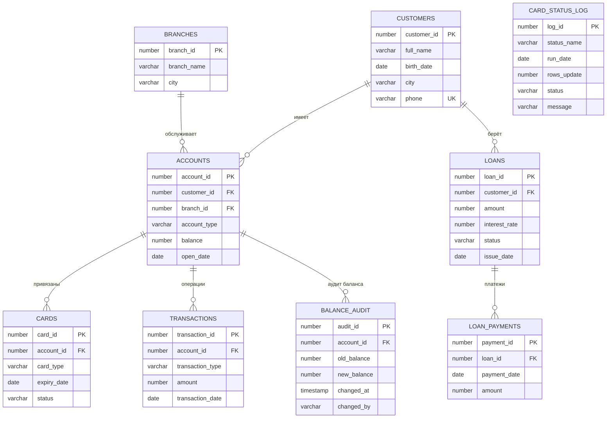

# Автоматизация учёта банковских операций (Oracle SQL / PL/SQL)

Учебный проект: база данных небольшого банка с контролем целостности данных, пакетом бизнес-операций, триггерами, аудитом и ночным заданием по расписанию.

**Проблема, которую решает проект:** баланс не обновлялся после транзакций, статусы карт устаревали, отчёты собирались вручную. Теперь баланс меняется через пакет `bank_pkg`, каждое изменение попадает в аудит, а просроченные карты закрываются автоматически.

## Что реализовано

- **Схема:** `NOT NULL`, `UNIQUE` на телефон, `CHECK` на статусы, типы и суммы (`amount > 0`, `balance >= 0`), автогенерация `transaction_id` через `SEQUENCE`, индексы на внешние ключи, таблицы `loan_payments`, `balance_audit`, `card_status_log`.
- **Качество данных:** поиск карт с истёкшим сроком и статусом «Активна», поиск клиентов без счетов и карт, скрипт исправления.
- **Представления:** `v_customer_360`, `v_branch_performance`, `v_monthly_turnover`, `v_overdue_loans`.
- **Пакет `bank_pkg`:** `deposit`, `withdraw`, `transfer`, `apply_interest`, `get_customer_balance`. Везде обработка ошибок: `RAISE_APPLICATION_ERROR`, блоки `EXCEPTION`, откат к `SAVEPOINT`.
- **Триггеры:** аудит изменения баланса, запрет операций по счёту без действующей карты.
- **Автоматизация:** ночное задание `DBMS_SCHEDULER` (процедура `expire_cards`) с логом в `card_status_log`.
- **Тесты:** негативные тесты ограничений, ручные тесты `deposit`, `withdraw`, `transfer`, `apply_interest`, `get_customer_balance`, обоих триггеров и тест процедуры `expire_cards` (успешный сценарий и ошибки, ожидаемый результат записан в комментариях).

## ER-диаграмма



`CARD_STATUS_LOG` ни с чем не связана: это журнал запусков ночного задания.

## Структура репозитория

```
01_schema/     ограничения, последовательность, индексы, новые таблицы
02_data/       проверка качества данных и исправление
03_views/      представления для отчётов
04_packages/   пакет bank_pkg
05_triggers/   триггеры, процедура expire_cards, ночное задание
06_tests/      тестовые скрипты
README.md
```

## Порядок запуска

Требуется Oracle 12c или новее (`IDENTITY`, значение по умолчанию из последовательности). Подойдёт SQL Developer или FreeSQL. Исходные таблицы `branches`, `customers`, `accounts`, `cards`, `transactions`, `loans` и их данные уже есть в базе по условию проекта.

Скрипты выполняются строго по порядку, потому что одни объекты зависят от других.

| Шаг | Файл | Что делает |
|-----|------|------------|
| 1 | `01_schema/01_check_violations.sql` | проверка: нет ли данных, которые нарушат ограничения (везде должно быть 0) |
| 2 | `01_schema/02_constraints.sql` | `NOT NULL`, `UNIQUE`, `CHECK` |
| 3 | `01_schema/03_sequence_transactions.sql` | автогенерация `transaction_id` |
| 4 | `01_schema/04_indexes.sql` | индексы на внешние ключи |
| 5 | `01_schema/05_new_tables.sql` | `loan_payments`, `balance_audit`, `card_status_log` |
| 6 | `02_data/01_data_quality_checks.sql` | поиск проблем в данных |
| 7 | `02_data/02_data_fix.sql` | исправление статусов просроченных карт |
| 8 | `03_views/*.sql` | четыре представления |
| 9 | `04_packages/bank_pkg.sql` | спецификация и тело пакета |
| 10 | `05_triggers/01_trg_balance_audit.sql` | аудит баланса |
| 11 | `05_triggers/02_trg_check_card_status.sql` | запрет операций без действующей карты |
| 12 | `05_triggers/03_expire_cards.sql` | процедура перевода карт в «Истекла» |
| 13 | `05_triggers/04_job_expire_cards.sql` | ночное задание (нужно право `CREATE JOB`) |
| 14 | `06_tests/test_constraints.sql` | негативные тесты ограничений |
| 15 | `06_tests/test_deposit_withdraw.sql`, `test_transfer.sql`, `test_function_and_interest.sql`, `test_triggers.sql` | ручные тесты пакета и триггеров: запускать по одному запросу и сравнивать с комментарием «Ожидаем» (в конце каждого файла `ROLLBACK`) |
| 16 | `06_tests/test_expire_cards.sql` | тест процедуры `expire_cards` (делает `COMMIT`, данные возвращает сам) |

Перед запуском тестов выполните `SET SERVEROUTPUT ON`.

## Принятые решения

- **`COMMIT` в пакете не делается.** Транзакцией управляет тот, кто вызывает процедуру. Каждая процедура при ошибке откатывает только свои изменения (`ROLLBACK TO SAVEPOINT`) и пробрасывает ошибку дальше (`RAISE`). `COMMIT` есть только в `expire_cards`, потому что задание работает само.
- **Аудит пишет триггер,** поэтому из пакета в `balance_audit` ничего не пишется. Любое изменение `accounts.balance` (через пакет или напрямую) попадает в аудит.
- **`transfer`:** блокирует счёт отправителя, проверяет баланс, списывает и зачисляет. Если счёта получателя нет, весь перевод откатывается. В `transactions` пишется одна запись «Перевод» по счёту отправителя.
- **Триггер карты:** операция по счёту запрещена, если у счёта есть карты, но ни одна не действует (статус «Активна» и срок не истёк). Если карт нет совсем, операция разрешена. Счёт получателя перевода не проверяется.
- **Карта считается просроченной,** если `expiry_date < TRUNC(SYSDATE)`. Это правило одинаково в исправлении данных, триггере и задании.
- **Отрицательный баланс** запрещён ограничением `chk_accounts_balance`, а не триггером: так надёжнее.
- **`apply_interest`** округляет результат до двух знаков. Запись в `transactions` не пишется, потому что среди допустимых типов операций («Пополнение», «Снятие», «Перевод») нет подходящего.

## Коды ошибок

| Код | Смысл |
|-----|-------|
| -20001 | Недостаточно средств |
| -20002 | Неверная сумма (пустая, ≤ 0, больше двух знаков после запятой) или неверная ставка |
| -20003 | Счёт не найден |
| -20004 | Перевод на тот же счёт |
| -20005 | Клиент не найден |
| -20010 | Нет действующей карты у счёта (триггер) |

## Известные ограничения и идеи для развития

- Создание задания в `DBMS_SCHEDULER` требует права `CREATE JOB`. Процедура `expire_cards` проверена вручную (`EXEC expire_cards`), запуск по расписанию в 02:00 требует выдачи этого права.
- `transfer` блокирует только счёт отправителя. При одновременных встречных переводах возможна взаимная блокировка (ORA-00060). Улучшение: блокировать оба счёта всегда в одном порядке, например по возрастанию `account_id`.
- Бонусные задания (оконные функции, `MERGE`, партиционирование, `EXPLAIN PLAN`) не реализованы.

## Для резюме

Проект на Oracle SQL/PL/SQL: схема с ограничениями, пакеты, триггеры, аудит, задания по расписанию.
